<!--
  LUCAS.PAZ // PROFILE README
  Theme: CYBER//RONIN — original anime-cyberpunk illustration
  Built to work in GitHub's README renderer. No custom HTML/CSS injection.
  Required local asset: ./assets/lucas-anime-banner.svg
-->

<div align="center">
  
  <br />
  <br />

  <a href="https://lucaspaz.com"></a>
  <a href="https://www.linkedin.com/in/lucaswcg/"></a>
  <a href="mailto:eu@lucaspaz.com"></a>
  <a href="https://github.com/luscas?tab=repositories"></a>

  <br /><br />

  

  <br />
  <sub><b>BRASIL 🇧🇷  ·  TECHNOLOGY EXECUTIVE  ·  HANDS-ON ARCHITECT  ·  OPEN TO GLOBAL CONNECTIONS</b></sub>
</div>

---

## `ARC 01` // THE PERSON BEHIND THE ARCHITECTURE

I'm **Lucas Paz**, a **CTO, technology leader, and hands-on software architect** with **12+ years of experience** turning complex technical challenges into real business outcomes.

My work lives where **engineering depth meets executive strategy**: defining technology direction, designing resilient systems, leading teams, and still getting close to the code when a hard problem needs solving.

**My strongest languages are Go, Rust, Python, and PHP/Laravel.** I work extensively with **AWS, Kubernetes, distributed systems, data platforms, and AI infrastructure**—with a particular interest in performance, operational simplicity, and scaling responsibly.

```text
┌─ lucas@production ~
│ ROLE      CTO / Software Architect / Builder
│ CORE      Go · Rust · Python · Laravel
│ TERRAIN   AWS · Cloud-native · Distributed Systems · AI
│ MINDSET   Business impact > technical theater
└─ STATUS    designing, building, shipping...
```

## `ARC 02` // IMPACT OVER HYPE

| **COMMERCE & GROWTH** | **MISSION-CRITICAL SYSTEMS** | **INDUSTRY & ESG** |
| :--- | :--- | :--- |
| Experience supporting a commerce growth journey from **~R$10M to ~R$500M in GMV**. | Architecture experience in digital operations processing **R$1M+ per day**. | Industrial technology initiatives, including **carbon-footprint solutions** and work described as recognized by **CNI**. |

The work behind those numbers spans more than software delivery:

- **Technology leadership:** architecture strategy, technical roadmaps, engineering teams, product trade-offs, and execution under growth pressure.
- **Platform engineering:** high-throughput APIs, asynchronous workflows, event-driven integration, fault tolerance, and practical observability.
- **Cloud at scale:** AWS infrastructure, container orchestration, deployment automation, resilience, security, and cost-aware engineering.
- **Digital operations:** payments, commerce, ERP/WMS integrations, inventory, marketplaces, and data-intensive workflows.
- **Applied AI:** LLM integration, generative-media pipelines, model-serving infrastructure, and multi-provider orchestration.

<sub>Scale figures describe business operations and projects I've worked on; they are not claims of individual ownership or live platform metrics.</sub>

## `ARC 03` // TECHNICAL LOADOUT

<div align="center">

### `S-TIER` · LANGUAGES & FRAMEWORKS I WORK IN DEEPLY


<br />


</div>

### ☁️ Cloud / DevOps / SRE


`EKS` · `EC2` · `RDS` · `S3` · `SES` · `CloudWatch` · `CI/CD` · `Infrastructure as Code`

### ⚡ Backend / Distributed Systems / Data


`Rust / Axum` · `Go services` · `Python / FastAPI` · `PHP / Laravel` · `Message queues` · `Event-driven design`

### 🔭 Observability / AI / Product Engineering


`Jaeger` · `Loki` · `Tempo` · `LLM inference` · `Model orchestration` · `Generative AI` · `Vue.js`

<details>
  <summary><b>⛩️ EXPAND // HOW I THINK ABOUT SYSTEMS</b></summary>
  <br />

  I don't choose a stack because it's fashionable. I choose it because it solves the right problem at the right operational cost.

  | **Concern** | **Engineering principles** |
  | :--- | :--- |
  | Architecture | Domain boundaries, explicit contracts, loose coupling, incremental evolution |
  | Performance | Measurement first, profiling, caching, backpressure, sensible concurrency |
  | Reliability | Timeouts, retries, idempotency, graceful degradation, recovery plans |
  | Delivery | Repeatable builds, GitOps/pull-based deployment, automated checks, safe rollouts |
  | Operations | Traces, metrics, logs, SLOs, incident learning, predictable cloud spend |
  | Leadership | Ownership, high-trust teams, measurable outcomes, technical clarity |

</details>

## `ARC 04` // SELECTED MISSIONS

| Mission | What I'm working on / have worked on |
| :--- | :--- |
| **[DROPPY](https://droppy.dev)** · Cloud & Digital Growth | Cloud architecture, intelligent automation, enterprise integration, data, and scalable digital operations. |
| **[IMERSY.AI](https://imersy.ai)** · Generative AI | AI-powered creative experiences, media pipelines, inference economics, and multi-model infrastructure. |
| **Commerce & Payments** · High Scale | Resilient transaction flows, integrations, subscription journeys, event-driven services, and growth-oriented platforms. |
| **Industrial ESG** · Real-world Impact | Carbon-footprint technology and enterprise software connecting data, sustainability, and operational decisions. |

> **My engineering philosophy:** Build for today's constraints, design for tomorrow's scale, and measure what actually matters to the business.

## `FINAL ARC` // LET'S BUILD SOMETHING THAT MATTERS

<div align="center">

**Complex systems. Clear decisions. Measurable impact.**

<a href="https://www.linkedin.com/in/lucaswcg/"></a>
<a href="mailto:eu@lucaspaz.com"></a>

<br /><br />

<sub><code>「 技術 × 戦略 」</code> · TECHNOLOGY × STRATEGY</sub>
<br />
<sub><b>BUILD // SHIP // SCALE</b></sub>

</div>